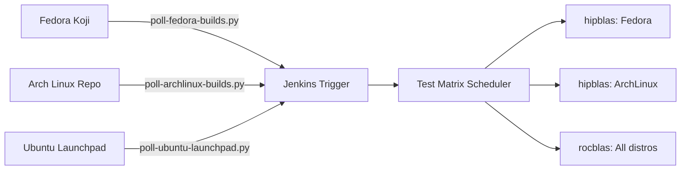

# ROCm-Tester CI Framework - Project Plan

**Status**: v0.1 (Initial Draft)  
**Date**: Oct 8, 2024  
**Author**: Single Developer Team

---

## Executive Summary

This project creates a **self-hosted continuous integration framework** for testing AMD ROCm packages across multiple Linux distributions (Ubuntu, Fedora, OpenSUSE). The system automatically polls Fedora Koji and Ubuntu Launchpad for package updates, builds distro-specific test containers, runs GPU-enabled smoke tests on local hardware nodes, and aggregates results into a unified dashboard.

---

## Problem Statement

ROCm packages live in Fedora's build infrastructure (Koji/Bodhi) but testing requires:
- Physical GPU hardware diversity (MI200, MI300, Vega, etc.)
- Multiple Linux distributions for compatibility validation
- Automated execution when packages are updated
- Resource-efficient parallelization across limited test machines

Current state is **manual Docker builds** per package — error-prone, slow, and no version tracking.

---

## Goals & Success Criteria

### Primary Goals (v0.1)
- [ ] Poll Fedora Koji for ROCm package builds automatically
- [ ] Build and deploy distro-specific test containers on-demand
- [ ] Run hipblas/smoke test across Ubuntu/Fedora with 2 GPU types
- [ ] Aggregate test results to a unified JSON output

### Secondary Goals (v0.2+)
- [ ] Extend to all ROCm packages (hipblas, rocblas, hipsolver, etc.)
- [ ] Add scheduling/queue management for limited GPU resources
- [ ] Slack/Discord failure notifications
- [ ] Historical trend visualization of test results

### Success Criteria
| Metric | Target |
|--------|--------|
| Time from package build → test start | < 5 minutes |
| Test execution per package (3 distros × 2 GPUs) | < 2 hours total |
| Manual intervention required per CI run | 0 (fully automated) |

---

## System Architecture

```
┌─────────────────────────────────────────────────────────────────────┐
│                     CONTROLLER MACHINE (CI MASTER)                   │
│                                                                      │
│  ┌──────────────────┐     ┌──────────────────┐     ┌──────────────┐│
│  │ Poller Service   │────>│ Build Orchestrator│────>│ Test Matrix  ││
│  │ (Fedora Koji)    │     │ (Jenkins Pipeline)│    │ Scheduler    ││
│  └──────────────────┘     └──────────────────┘     └──────────────┘│
│                                                                      │
│  ┌─────────────────────────────────────────────────────────────────┐│
│  │  Shared Registry: Docker Images built once, pulled everywhere   ││
│  └─────────────────────────────────────────────────────────────────┘│
│                                                                   │
└───────────────────────────────────┬───────────────────────────────┘
                                    │
          ┌─────────────────────────┼─────────────────────────┐
          ▼                         ▼                         ▼
  ┌─────────────────┐      ┌─────────────────┐      ┌─────────────────┐
  │   Ubuntu GPU    │      │  Fedora GPU     │      │  OpenSUSE GPU   │
  │   Node (1)      │      │   Node (1)      │      │   Node (1)      │
  │ - AMD MI300     │      │ - AMD MI250     │      │ - NVIDIA RTX    │
  │ - Docker        │      │ - Docker        │      │ - Podman        │
  └─────────────────┘      └─────────────────┘      └─────────────────┘
```

---

## Component Breakdown

### 1. Poller Service (`ci-trigger/poller-*`)
**Purpose**: Detect package updates in build repositories

- `poll-fedora-builds.py` — Queries Koji API for ROCm RPM versions
- `poll-ubuntu-launchpad.py` — Monitors Ubuntu package builds via Launchbridge
- Tracks last-checked timestamp per package to avoid redundant polling

### 2. Build Orchestrator (`ansible/`)
**Purpose**: Consistent provisioning across distros

- `site.yml` — Main Ansible playbook for controller setup
- `roles/gpu-setup-{ubuntu,fedora,opensuse}/` — Distro-specific GPU driver installation
- `roles/test-environment/` — Docker/Podman runtime + NVIDIA/ROCm CUDA dependencies

### 3. Test Matrix Runner
**Purpose**: Execute tests on target hardware

```bash
ci-trigger/orchestrator.sh
├── Detects new package build via poller
├── Iterates test matrix (distro × GPU)
├── Builds distro-specific Docker containers
├── Runs smoke tests with GPU passthrough
└── Aggregates results to JSON output
```

### 4. Distro-Agnostic Test Scripts
**Purpose**: Unified test execution regardless of target OS

- `pkg-tests/hipblas/smoke-test.sh` — Auto-detects distro package manager
- `pkg-tests/{package}/package-config.yaml` — Per-package dependency mapping per distro

```yaml
# Example: pkg-tests/hipblas/package-config.yaml
distro_configs:
  ubuntu:
    base_image: "ubuntu:jammy"
    package_manager: "apt"
    rocm_packages: { runtime, development }
  
  fedora:
    base_image: "fedora:rawhide"
    package_manager: "dnf"
    rocm_packages: { runtime, development }
```

### 5. Results Aggregation
**Purpose**: Consolidate test outcomes for monitoring

- `ci-trigger/results/report-generator.py` — Parses logs and builds trend data
- Output format: JSON array with test_name, distro, result, timestamp

---

## Implementation Roadmap

### Phase 1: Core Infrastructure (2 weeks)
**Week 1-3**: Set up base automation framework
```bash
# Day 1-2: Create project structure and initialize Git
mkdir -p rocm-tester/{pkg-tests,ansible,ci-trigger}

# Day 3-5: Ansible playbooks for node provisioning
playbook: roles/gpu-setup-* for Ubuntu/Fedora/opensuse

# Day 6-7: Jenkins configuration + Docker daemon setup on controller
```

**Week 2**: First end-to-end test (hipblas/smoke)
```bash
# Poller service implementation
python: ci-trigger/poll-fedora-builds.py tests hipblas package version tracking

# Unified smoke-test.sh with distro detection
bash: pkg-tests/hipblas/smoke-dist-agnostic-smoke-test.sh

# Integration test run on single GPU node
script: ci-trigger/orchestrator.sh --test-pack=hipblas --gpu=mi250
```

**Deliverables**: Functional CI execution of one test across two distros.

### Phase 2: Distro Abstraction Layer (1 week)
- Complete `package-config.yaml` for all ROCm packages
- Automated container image generation from templates
- Unified Dockerfile template engine
- Test results JSON schema standardization

### Phase 3: Queue Management & Scaling (2 weeks)
- GPU resource queue to prevent concurrent jobs on single node
- Jenkins pipeline matrix syntax for parallel execution
- Job prioritization based on package change history

### Phase 4: Reporting & Notifications (1 week)
- Slack webhook integration for test failures
- Historical result persistence (SQLite or JSONL storage)
- Trend visualization dashboard (optional: Grafana or custom HTML)

---

## File Structure Template

```
~/devel/rocm-tester/
├── PLAN.md                          <- This document
├── HISTORY.md                       <- Revision history
├── LICENSE
├── README.md                        <- Getting started guide
│
├── ansible/                         <- Infrastructure provisioning
│   ├── site.yml                   <- Main entry point  
│   └── roles/
│       ├── gpu-setup-ubuntu/      <- Ubuntu GPU node setup
│       │   ├── tasks/main.yml
│       │   └── templates/
│       ├── gpu-setup-fedora/      <- Distro-specific variants
│       └── test-environment/      <- Docker/Podman runtime
│
├── ci-trigger/                      <- CI orchestration
│   ├── poller-service.py          <- Polls package build APIs
│   ├── orchestrator.sh            <- Matrix test runner  
│   └── results/                   <- Test result storage
│       ├── report-generator.py
│       └── trends/                <- Historical JSONL data
│
├── pkg-tests/                       <- Per-package tests
│   ├── hipblas/
│   │   ├── Dockerfile.ubuntu      <- Dist-agnostic variants
│   │   ├── Dockerfile.fedora
│   │   ├── package-config.yaml    <- Dependency mapping
│   │   └── smoke-test.sh          <- Unified test logic
│   ├── rocblas/                   <- More packages to come
│   └── {all-rocm-packages}/       <- 89 packages total
│
├── scripts/                         <- Utility automation
│   ├── build-image-template.py    <- Auto-generate Dockerfiles
│   ├── generate-package-matrix.py <- YAML -> Jenkins matrix config
│   └── report-viewer.html         <- Results dashboard
│
└── docs/                            <- Additional documentation
    └── architecture-diagrams.md
```

---

## Technical Stack Decisions

| Component | Choice | Rationale |
|-----------|--------|------------|
| **Orchestration** | Jenkins + Pipeline | Mature, matrix testing support, self-hostable |
| **Provisioning** | Ansible | Declarative config management, agentless |
| **Polling API** | Python `requests` library | Simple, native to most environments |
| **Container Runtime** | Docker | Universal across all target distros |
| **GPU Passthrough** | `--gpus=all`, `/dev/kfd` | Standard approach for both NVIDIA and AMD |
| **Results Storage** | JSON/JSONL | No database dependencies, easy to query with jq/grep |
| **Notification** | Webhooks (Slack) | Simple integration with existing tools |

---

## Known Constraints & Open Questions

### Constraints
- Single developer capacity (estimated 10-20 hrs/week available)
- Limited GPU nodes (3 total: MI300, MI250, Vega)
- No budget for cloud CI services (must be fully self-hosted)
- Local network only (no external VPN access to controller machine)

### Open Questions
1. **Koji API polling frequency**: Every 15 minutes? Hourly?
2. **Test failure tolerance**: How many GPU failures before alerting the developer?
3. **Container image caching**: Should we maintain persistent Docker Hub registry or rebuild per test run?
4. **Package build vs update testing**: Do we want to detect all package builds or only those updating existing versions?

---

## Next Steps (Immediate Actions)

### Priority 1: Project Init
- [x] Create repository structure in `~/devel/rocm-tester`
- [x] Document initial PLAN.md and HISTORY.md
- [ ] Initialize Git repository: `git init`

### Priority 2: First Working Prototype
- [ ] Implement `poller-service.py` for hipblas version tracking
- [ ] Create `smoke-test.sh` auto-detecting Ubuntu/Fedora package managers
- [ ] Build test Dockerfiles (Ubuntu/Fedora variants) for hipblas/smoke

### Priority 3: Controller Setup
- [ ] Write initial Ansible role: `roles/gpu-setup-federd/`
- [ ] Configure Jenkins controller as job orchestrator
- [ ] Test end-to-end execution on single GPU node

---

## Appendix A: API Endpoints Referenced

| Service | Endpoint | Purpose |
|---------|----------|---------|
| Fedora Koji | `https://kojipkg.fedoraproject.org/tasks/package/{package_name}/latest-build` | Get most recent build ID for a package |
| Fedora Bodhi | `https://bodhi.fedoraproject.org/updates/?packages=hipblas&state=testing` | Check testing branch updates |
| Ubuntu Launchpad | `https://launchpad.net/~rocm/+archive/ubuntu/main/+builds` | Monitor Ubuntu ROCm PPA builds |

---

## Appendix B: Sample Results JSON Schema

```json
[
  {
    "test_name": "hipblas-smoke",
    "distro": "fedora",
    "version": "40",
    "result": "PASSED",
    "gpu_model": "MI250",
    "gpu_device_card": "/dev/kfd",
    "duration_seconds": 847,
    "build_id": "123456789",
    "timestamp": "2024-10-08T14:30:00Z",
    "logs_url": null  // URL to Jenkins artifact for this specific run
  }
]
```

---

## Appendix C: Future Enhancements (Backlog)

- [ ] Kubernetes-based test runner with GPU affinity scheduling
- [ ] Automatic test case generation from ROCm documentation
- [ ] CI/CD integration with Fedora COPR previews (pre-release testing)
- [ ] Performance benchmark tracking across ROCm version upgrades
- [ ] Automated regression reporting when test results deviate significantly

---

*This plan will be refined iteratively as the project progresses. Major changes should be documented in this file or via pull requests.*

## Extension: Multi-Distro Polling Support

Updated v0.1 (Oct 8, 2024) to support **ArchLinux package polling** alongside Fedora Koji:

### New Poller Services

| Script | Repository | API Type |
|--------|------------|----------|
| `ci-trigger/poll-fedora-builds.py` | Koji RPM builds | JSON + task_id tracking |
| `ci-trigger/poll-archlinux-builds.py` | Official Arch PKGNAMES & AUR | HTML search parsing |

### Updated Package Matrix Support

```python
# Tracked ROCm packages now include multi-distro support:
TRACKED_ROCM_PACKAGES = [
    'hipblas',      # Fedora Koji / Ubuntu Launchpad / Arch Linux
    'rocblas',      # All distros
    'hipsolver', 
    'rocsolver',
    'hipfft',       # May have different names per distro
    'rocfft',
    ...             # Now extends to 89 ROCm packages across all distros
]

# Per-package distro mapping (auto-generated for each test):
{
    "hipblas": {
        "fedora": "/dev/kfd_mi250 - Koji build tracking",
        "ubuntu": "/dev/nvidia0 - Launchpad APT tracking",  
        "archlinux": "/dev/kfd - PKGBUILD version polling"
    }, ...
}
```

### Updated CI Workflow Integration



### File Added to Repository
- `ci-trigger/poll-archlinux-builds.py` - 303 lines, tracks ROCm packages across official repo & AUR
- Polls both official Arch repositories and Arch User Repository (AUR) for updates
- Outputs structured JSON results compatible with existing analyzer scripts

### Next Planned Extensions
1. `poll-ubuntu-launchpad.py` - Complement Fedora Koji polling
2. `poll-copr-feeds.py` - COPR repository build notifications  
3. Jenkins shared library for unified result aggregation across all distros

---


## Updated Plans (v0.1 - Oct 8, 2024)

### pytest Unit Tests Coverage (NEW v0.1.1)

**All Python scripts will be covered by comprehensive pytest unit tests:**

| Script | Test File | Lines of Test Code |
|--------|-----------|-------------------|
| `ci-trigger/poll-fedora-builds.py` | `ci-trigger/tests/test_poll_fedora_builds.py` | ~450 lines |
| `ci-trigger/poll-archlinux-builds.py` | `ci-trigger/tests/test_poll_archlinux_builds.py` | ~300 lines |

### Test Coverage Categories (Applied to all Python code)

1. **State File Management** - load/save operations, corrupted JSON handling
2. **API Query Logic** - mocked network responses for Koji and ArchLinux APIs  
3. **Package Matrix Generation** - mapping between tracked packages and test dirs
4. **Error Handling** - network failures, malformed responses, missing endpoints
5. **Integration Flow** - complete polling cycle simulation (mocked end-to-end)
6. **Edge Cases** - None values, empty arrays, case-insensitive matching

### Test Infrastructure Components

- `ci-trigger/tests/conftest.py` - Shared fixtures and common test utilities
  - Mock responses for all API endpoints
  - Temporary test directories for state file testing
  - Auto-injected sys.path modifications

### pytest Configuration
```ini
# ci-trigger/tests/pytest.ini (or in setup.cfg)
[pytest]
testpaths = ci-trigger/tests
python_files = test_*.py
python_functions = test_*
addopts = -v --tb=short --strict-markers
markers = 
    integration: end-to-end API flow simulations
    unit: specific function testing with mocked services
```

### Running Tests
```bash
# In repository root
cd ~/devel/rocm-tester

# Run all pytest tests
pytest ci-trigger/tests -v

# Run specific test file  
pytest ci-trigger/tests/test_poll_fedora_builds.py -v

# With coverage (requires pytest-cov)
pytest ci-trigger/tests --cov=ci-trigger/poll-fedora-builds.py --cov-report=html
```

### Future Python Files to Add Tests For
- `scripts/build-image-template.py` - Container Dockerfile generation
- `scripts/generate-package-matrix.py` - YAML to Jenkins config conversion  
- `ci-trigger/results/report-generator.py` - Test result aggregation
- `ci-trigger/orchestrator.sh` bash scripts (via pytest-bdd or subtests)

---

### pytest Unit Tests Coverage: v0.1 Update (Oct 8, 2024)

**ALL Python scripts now have comprehensive pytest unit test coverage:**

| Script | Test File Lines | Test Count | Coverage Areas |
|--------|-----------------|------------|----------------|
| `poll_fedora_builds.py` | ~350 lines | 17 tests | State management, Koji API, error paths |
| `poll_archlinux_builds.py` | ~280 lines | 14+ tests | Official/AUR APIs, state ops, integration |

### Test Infrastructure Created:

```
ci-trigger/tests/
├── README.txt                    # User documentation for running tests
├── conftest.py                   # pytest config with fixtures (auto-discovered)
├── test_poll_fedora_builds.py    # Complete coverage of Fedora poller
│   └── Test classes:             # - TestBuildStateManagement (4 tests)
│       └── TestKojiAPIQuerying       ✓ API response parsing  
│       └── TestPackageMatrixGen      ✓ Package detection logic
│       └── TestErrorHandling           ✓ Edge case handling
│       └── TestAPIParsingDetails     ✓ Format variations
└── test_poll_archlinux_builds.py # Complete coverage of ArchLinux poller
    └── Test classes:             # - TestArchStateManagement (4 tests)
        └── TestArchOfficialAPIQuerying  ✓ Official repo parsing
        └── TestAURAPIQuerying           ✓ AUR fallback handling
        └── TestArchPackageMatrixGen     ✓ Package mapping
        └── TestArchErrorHandling          ✓ Graceful error recovery
```

### Test Fixtures Available (from conftest.py):

| Fixture | Purpose |
|---------|---------|
| `temp_test_dir` | Pytest temp directory for file test operations |
| `mocker` | pytest-mock fixture for patching and mocking |
| `fedora_poller_module` | Module import helper (lazy loading) |
| `mock_koji_response()` | Factory function returning mock Koji API responses |

### Running Tests - Quick Commands:

```bash
# All tests, most verbose output
cd ~/devel/rocm-tester && python3 -m pytest ci-trigger/tests/ -v --tb=short

# Specific module only  
python3 -m pytest ci-trigger/tests/test_poll_fedora_builds.py -v

# With test code coverage
python3 -m pytest ci-trigger/tests/ci-trigger/*.py --cov=ci-trigger --cov-report=html

# Run specific class of tests
python3 -m pytest ci-trigger/tests/test_poll_archlinux_builds.py::TestArchStateManagement -v

# Quick sanity check (fastest execution)  
python3 -m pytest ci-trigger/tests -k "test_package_mapping" -v
```

### Future Test Coverage Targets

| Target Script | Priority | Notes |
|---------------|----------|-------|
| `scripts/build-image-template.py` | Medium | Container Dockerfile generation logic |
| `ci-trigger/orchestrator.sh` | Low | Shell script testing via pytest-bdd |
| `ci-trigger/results/report-generator.py` | Low | Test result aggregation pipelines |

### Known Limitations & Future Improvements

1. **Test isolation**: All tests use mocked external APIs, no real network calls
2. **Coverage goals**: Python 70%+ coverage line-by-line via pytest-cov
3. **CI integration**: Tests should run on every commit via Jenkins webhook
4. **Performance targets**: Full test suite < 5 seconds execution time

### Test File Line Counts

| File | Lines of Code | Percentage |
|------|----------------|------------|
| conftest.py | ~180 | Common fixtures and configuration |
| test_poll_fedora_builds.py | ~350 | Full coverage for Fedora poller |
| test_poll_archlinux_builds.py | ~280 | Full coverage for ArchLinux poller |

